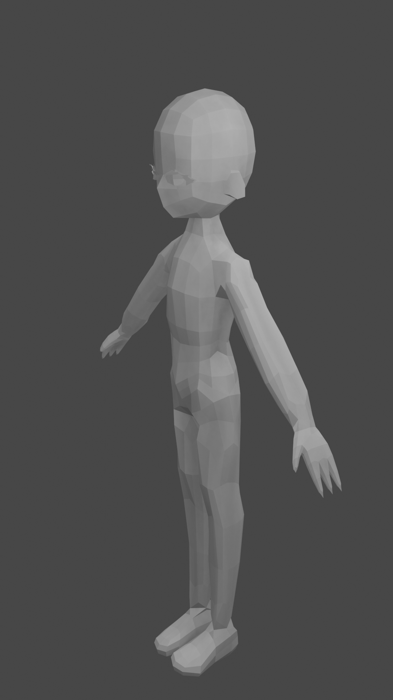
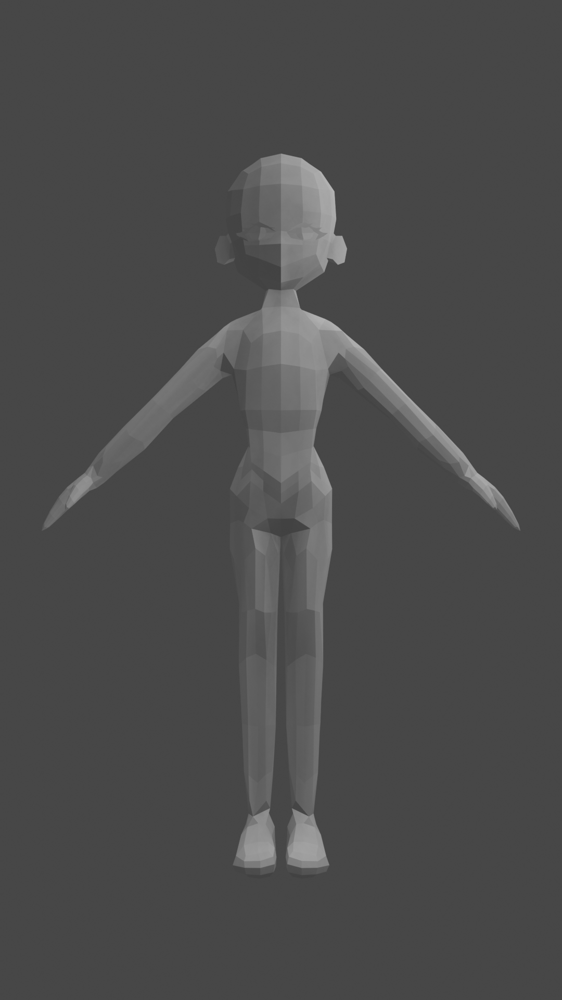
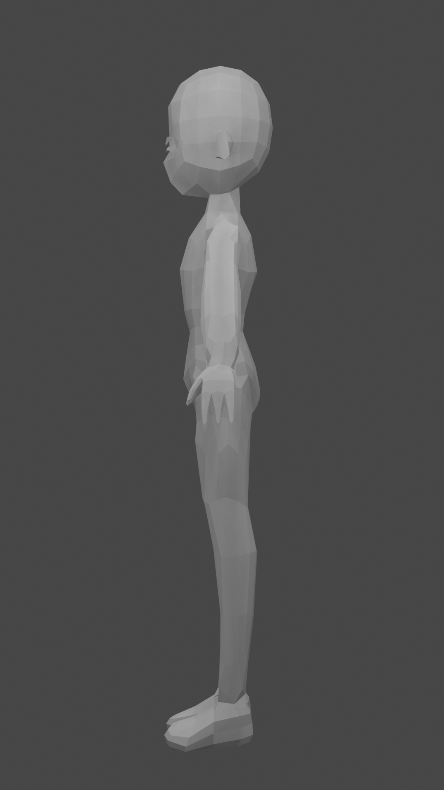
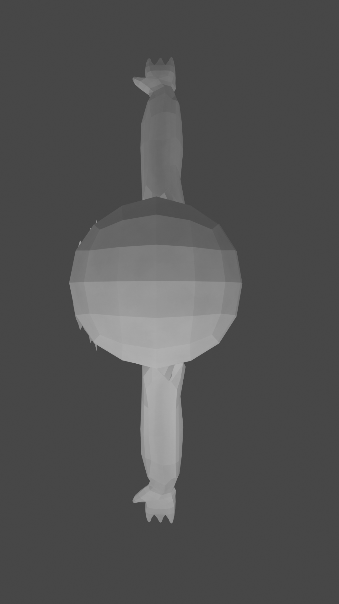

# Low-Poly Character (Rigged)

A low-poly humanoid character modeled in Blender and rigged with an armature (bones) for animation. This is a hobby project made for fun.

<p align="center">
  
</p>

## About

A stylized, faceted character in a neutral A-pose: a large rounded head, simple facial features, slim limbs and chunky shoes. The mesh is untextured, shown here with plain grey shading, so the low-poly form is easy to see. The model includes bones, so it is ready to be posed and animated.

## Renders

| Front | Side | Top |
|---|---|---|
|  |  |  |

## Files

```
├── character.blend    # model with armature (bones)
└── renders/           # PNG renders from several angles
```

## Software

- Blender 3.6

## Usage

Open `character.blend` in Blender 3.6 or newer. Select the armature and switch to Pose Mode to move the bones.

## Author

Anastasia Shestopal

